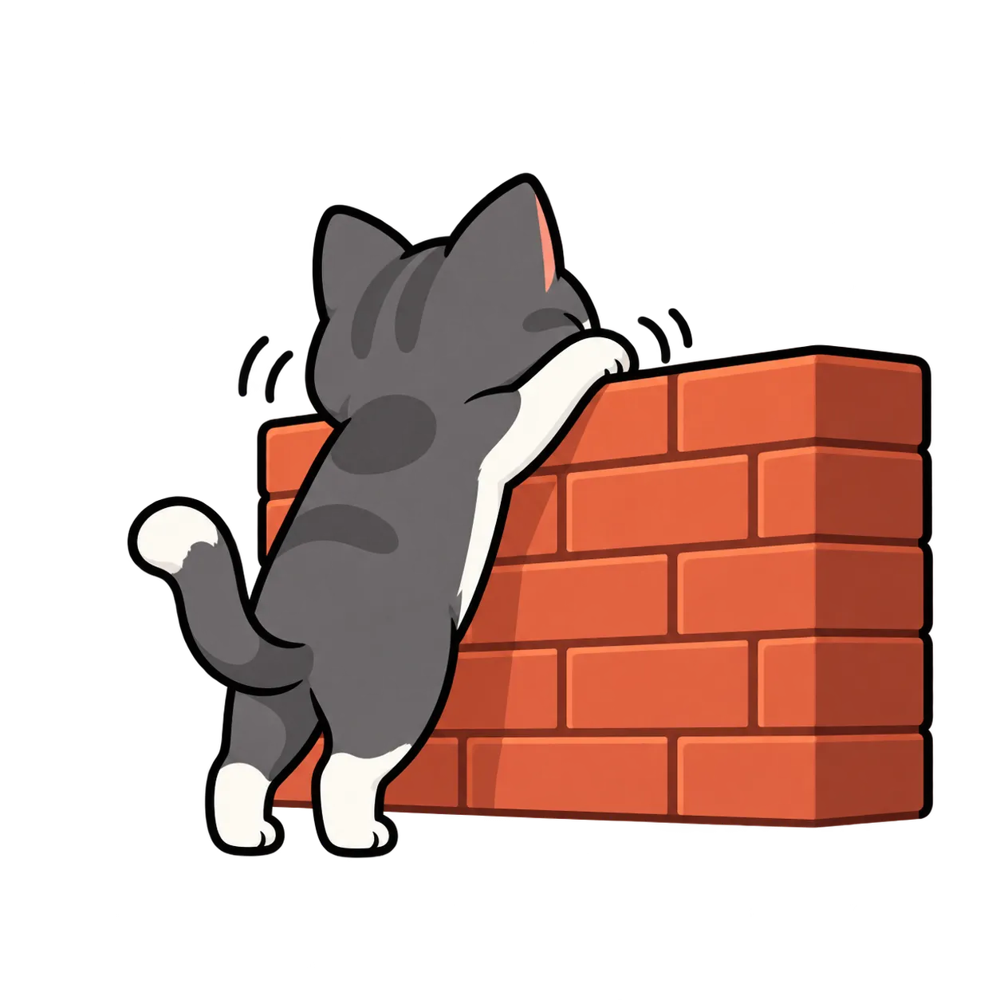

<p align="center">
  
</p>

<h1 align="center">Wafme0w</h1>

<p align="center">Identify WAF fingerprints from live HTTP responses or saved captures.<br>A Go CLI and library with structured reports.</p>

<p align="center">
  <a href="go.mod"></a>
  <a href="docs/usage.md"></a>
  <a href="LICENSE.md"></a>
</p>

<p align="center">
  <a href="#3-automate-and-save-results"></a>
  <a href="docs/usage.md#offline-captures"></a>
  <a href="https://github.com/Lu1sDV/wafme0w/actions/workflows/ci.yml"></a>
</p>

<p align="center"><a href="#1-build">Quick start</a> · <a href="#benchmarks">Benchmarks</a> · <a href="#documentation">Documentation</a></p>

## 1. Build

Use a security-patched Go toolchain; release builds pin **Go 1.27.3**.

```sh
git clone https://github.com/Lu1sDV/wafme0w.git
cd wafme0w
go build -o wafme0w ./cmd/wafme0w
./wafme0w --help
```

**Release caveat:** published v1.0.0 binaries predate this checkout’s security
hardening. Use a newly scanned patch release for production; source changes do
not update existing downloads. [Installation, Docker and release details](docs/releases.md).

## 2. Scan an authorized target

```sh
# Use your own local HTTP server on port 8080.
./wafme0w --target http://127.0.0.1:8080 --baseline --jsonl
```

`--baseline` sends a normal request; default mode sends up to nine active probes,
and `--fast` selects three. Redirects remain subject to scope and request budgets.

## 3. Automate and save results

```sh
# targets.txt: one authorized URL per line.
./wafme0w --input targets.txt --jsonl --output results.json --strict --rate 5
```

JSONL stays on stdout; human diagnostics go to stderr. `--strict` exits **2** after
publishing results when evidence or browser capture is incomplete/failed/diagnosed.
Configuration, input and output failures exit **1**; cancellation exits **130**.

## Benchmarks

Historical **wafme0w vs wafw00f**, 1,000 targets. Saved wall-clock timings—not measurements of this checkout:

| Workers / processes |  wafme0w fast |  wafme0w full | wafw00f |
| --- | ---: | ---: | ---: |
| 1 | 19m 10.43s | 30m 2.91s | 47m 3.94s |
| 10 | 3m 39.69s | 2m 49.17s | 9m 31.50s |
| 50 | 52.33s | 1m 19.59s | 4m 1.22s |

A fresh comparison on the same **Tranco top-500** targets is deferred; these
figures are not that run or detection-accuracy evidence. [Details and local performance measurements](docs/benchmarks.md).

## Major caveats

- Scan only systems you own or are authorized to test. Default and fast modes are active.
- A fingerprint match is evidence, not proof of WAF enforcement. No match is not proof of absence; incomplete is not negative.
- Optional Chromium capture is not an OS-enforced network or resource sandbox.

## Documentation

| Guide | Contents |
| --- | --- |
| [CLI usage](docs/usage.md) | Modes, headers, scope, byte limits and cancellation |
| [Browser capture](docs/browser.md) | Chromium setup, screenshots and sanitized exports |
| [Operations](docs/operations.md) | Result semantics, safe report consumption, deployment and soak checks |
| [Releases](docs/releases.md) | Installation, Docker, validation, security scans and publication controls |
| [Go library](docs/library.md) | Working example, ownership and streaming contracts |
| [Benchmarks](docs/benchmarks.md) | Reproducible measurements, offline comparison and historical results |

[MIT license](LICENSE.md) · Fingerprints from [wafw00f](https://github.com/EnableSecurity/wafw00f/) · Contributor [@Fibonaccispiralz](https://github.com/Fibonaccispiralz)
