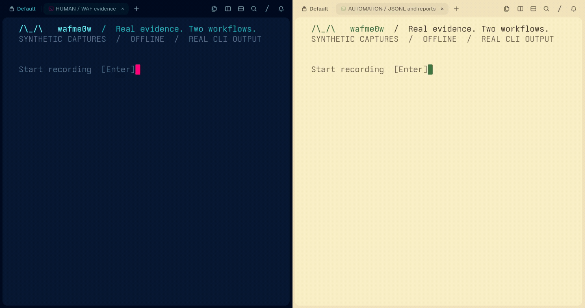

<p align="center">
  
</p>

<h1 align="center">Wafme0w</h1>

<p align="center"><strong>wafw00f's fingerprints. Go speed. Pipeline-native.</strong></p>

<p align="center"><strong>172 WAF product identities</strong>, built on wafw00f's fingerprints.<br>A Go CLI and library for live HTTP and offline saved-response analysis.</p>

<p align="center">
  <a href="https://github.com/Lu1sDV/wafmeow/actions/workflows/ci.yml"></a>
  <a href="go.mod"></a>
  <a href="docs/usage.md"></a>
  <a href="LICENSE.md"></a>
</p>

<p align="center">
  <a href="#3-automate-and-save-results"></a>
  <a href="docs/usage.md#httpx-response-import"></a>
  <a href="docs/library.md"></a>
</p>

<p align="center"><a href="#1-build">Quick start</a> · <a href="docs/migrating-from-wafw00f.md">Moving from wafw00f</a> · <a href="#benchmarks">Benchmarks</a> · <a href="#documentation">Documentation</a></p>

<p align="center">
  <a href="assets/demo/tern-demo-split.gif">
    <picture>
      <source media="(prefers-reduced-motion: reduce)" srcset="assets/demo/tern-demo-split.png">
      
    </picture>
  </a>
</p>

<p align="center">
  <a href="assets/demo/tern-demo-split.gif">Open full-size split demo</a>
</p>

## Why wafmeow?

wafmeow is a **wafw00f alternative** for WAF detection in Go, built on the upstream
project's fingerprint work. It brings fast WAF fingerprinting into concurrent,
structured pipelines for teams that need to detect WAF at scale.

- **172 product identities in the catalogue.** Fingerprints are ported from
  [wafw00f](https://github.com/EnableSecurity/wafw00f/), with upstream credit and
  [licence notices](LICENSE.md). Probe behavior and evidence semantics differ;
  catalogue size does not prove equivalent detection on every target.
- **Static Go release binaries.** No Python, pip or virtualenv is required
  to scan or classify saved responses. Optional browser capture needs Chromium.
- **JSONL, JSON and CSV output.** Stream to `jq`, notification tools or a database,
  while keeping human diagnostics on stderr.
- **Offline response analysis.** Re-analyse native captures or supported httpx
  exports without sending another request.
- **Request, redirect and connection budgets.** Bound acquisition and apply
  explicit scope rules across redirects.
- **An importable Go library.** Use the same evidence classifier in your own
  application through the [v2 API](docs/library.md).

### From discovery to JSONL

```sh
# Set AUTHORIZED_DOMAIN to a domain you own or are authorized to test.
set -o pipefail
subfinder -d "${AUTHORIZED_DOMAIN:?set an authorized domain}" -silent |
  httpx -silent |
  wafmeow --target-file - --baseline --jsonl --silent
```

This pipeline sends normal HTTP requests with `--baseline`. Remove that flag
only when the active probes are within your testing scope. For existing httpx
response exports, use the [offline import pipeline](#projectdiscovery-httpx-pipelines).

## 1. Build

Build with **Go 1.26 or newer**, using a security-patched toolchain. Release builds
use Go 1.27.3.

```sh
git clone https://github.com/Lu1sDV/wafmeow.git
cd wafmeow
go build -o wafmeow ./cmd/wafmeow
./wafmeow --help
```

For production, use a release that passes the [release validation gates](docs/releases.md#publication-gates).
The v1.0.0 downloads predate the security hardening in this source tree.

Prebuilt binaries, the Go module and Homebrew install are in
[Releases and installation](docs/releases.md#build-and-install):

```sh
go install github.com/Lu1sDV/wafmeow/v2/cmd/wafmeow@latest
brew install Lu1sDV/tap/wafmeow
```

## 2. Scan an authorized target

```sh
# Use your own local HTTP server on port 8080.
./wafmeow --target http://127.0.0.1:8080 --baseline --jsonl
```

Use `--target` / `-t` for a URL and repeat it for several URLs. Use
`--target-file PATH` for a file of URL lines, or `--target-file -` for stdin.
`--input PATH` and `-I PATH` remain equivalent spellings of `--target-file PATH`.
Choose one input source; saved responses use `--evidence` for offline analysis.

`--baseline` sends a normal request; default active mode sends up to nine requests,
and `--fast` selects three. Redirects remain subject to scope and request budgets.

### ProjectDiscovery httpx pipelines

```sh
# Discover URLs, then send new wafmeow requests:
httpx -l authorized-hosts.txt -silent |
  ./wafmeow --target-file - --baseline --jsonl --silent

# Classify exported responses without additional requests:
httpx -l authorized-hosts.txt -silent -json -irr -probe -rstr 1048576 -rsts 1048576 |
  ./wafmeow --evidence - --evidence-format httpx --jsonl --silent
```

The importer targets **httpx v1.12.0**. Exported bodies lack completeness proof:
content matching stays unknown, while faithful status/header/cookie evidence can
match. This is not equivalent to active acquisition or proof of WAF absence.
Use `set -o pipefail` when upstream process failures must fail the shell pipeline.
[Encoding, limitations, limits and downstream recipes](docs/usage.md#httpx-response-import).

The Go library uses module **`github.com/Lu1sDV/wafmeow/v2`**. Result JSON uses
schema 1; module and report versions are separate contracts.

## 3. Automate and save results

```sh
# targets.txt: one authorized URL per line.
./wafmeow --target-file targets.txt --jsonl --output results.json --strict --rate 5
```

`--jsonl` streams results on stdout; `--output` / `-O` writes an atomic report
whose extension selects JSON, JSONL, CSV or TXT. They can be used together.
Human diagnostics go to stderr. `--strict` exits **2** after
publishing results when evidence or browser capture is incomplete/failed/diagnosed.
Configuration, input and output failures exit **1**; cancellation exits **130**.

## Benchmarks

### Recorded live CLI comparison

Median elapsed time for **2,000 authorized HTTPS targets**, with **three runs per
configuration**, completed on 30 October 2026. Lower is better.

**CPU:** Intel Core Ultra 9 275HX (4 logical CPUs allowed) · **RAM:** 32 GB.

| Workers / processes | wafw00f 2.4.2 |  wafmeow fast |  wafmeow full | Speedup fast | Speedup full |
| ---: | ---: | ---: | ---: | ---: | ---: |
| 1 | 70m 27s | 29m 29s | 78m 05s | **2.39×** | 0.90× |
| 5 | 15m 26s | 7m 27s | 14m 30s | **2.07×** | **1.06×** |
| 10 | 7m 46s | 3m 48s | 7m 18s | **2.04×** | **1.07×** |
| 50 | 3m 45s | 49s | 1m 40s | **4.55×** | **2.24×** |
| 100 | 2m 45s | 28s | 1m 02s | **5.90×** | **2.66×** |

**Detection results at 100 workers/processes** — targets out of 2,000, shown as
the range across three runs.

| Targets with… | wafw00f 2.4.2 |  wafmeow fast |  wafmeow full |
| --- | ---: | ---: | ---: |
| Named WAF match | 856–858 | 853–858 | 845–852 |
| Generic WAF signal | 411–423 | 424–430 | 492–504 |
| Returned result | 1,534–1,545 | 2,000 | 2,000 |
| Complete evidence | Not reported | 1,437–1,460 | 1,368–1,410 |

Named matches and generic signals can overlap, including on incomplete results.
Different probes, TLS policies and evidence completeness prevent an accuracy
comparison. [Full results, methodology and build details](docs/benchmarks.md#live-cli-comparison).

The 2,000-target table predates HTTP/1 probe reuse
([ADR 0002](adrs/0002-http1-connection-reuse-for-probes.md)). At one worker, the
reused-connection full build completed a **500-target median of 580.9 s** versus
**874.6 s** for wafw00f 2.4.2 (1.51×); on the first 100 entries it was 96.4 s
versus 143.3 s (1.49×) and 173.4 s for the fresh-connection build (44% less
time). See the
[connection-reuse comparison](docs/benchmarks.md#connection-reuse-comparison)
for per-block accounting, paired A/B, scaling and controlled loopback results.

### Reproducible offline comparison

Run the [reproducible offline comparison](docs/benchmarks.md#reproduce-the-current-checkout)
against **wafw00f 2.4.2** from a clean committed checkout. The runner records source
and binary hashes, compiler and Python package versions, CPU details, the exact
synthetic corpus, repeated blocks and a verified result manifest. Workers replay
saved responses with network access isolated by bubblewrap.

The shipped synthetic-conformance fixture links cover **29 of 172 products**;
this checks conformance to fixture expectations. The live table measures
end-to-end CLI elapsed time, while the offline comparison isolates saved-response
classification. Keep each result attached to its workload and measured build.

## Major caveats

- Scan only systems you own or are authorized to test. Default and fast modes are active.
- A fingerprint match is evidence, not proof of WAF enforcement. No match is not proof of absence; incomplete is not negative.
- Optional Chromium capture is not an OS-enforced network or resource sandbox.

## Documentation

| Guide | Contents |
| --- | --- |
| [CLI usage](docs/usage.md) | Modes, headers, scope, byte limits and cancellation |
| [Moving from wafw00f](docs/migrating-from-wafw00f.md) | Common flag mappings, changed semantics and pipeline migration |
| [Browser capture](docs/browser.md) | Chromium setup, screenshots and sanitized exports |
| [Operations](docs/operations.md) | Result semantics, safe report consumption, deployment and soak checks |
| [Releases](docs/releases.md) | Installation, Docker, validation, security scans and publication controls |
| [Go library](docs/library.md) | Working example, ownership and streaming contracts |
| [Architecture decisions](adrs/README.md) | Design rationale, alternatives, experiments and decision status |
| [Benchmarks](docs/benchmarks.md) | Measurement methodology, results and offline conformance checks |
| [Contributing](CONTRIBUTING.md) | Development setup, reviewed fingerprint fixtures and starter tasks |
| [Security policy](SECURITY.md) | Private vulnerability reporting and supported versions |
| [Launch checklist](docs/launch.md) | Evidence-backed messaging, publication and repository settings |

[MIT license](LICENSE.md) · Fingerprints from [wafw00f](https://github.com/EnableSecurity/wafw00f/) · Contributor [@Fibonaccispiralz](https://github.com/Fibonaccispiralz)
